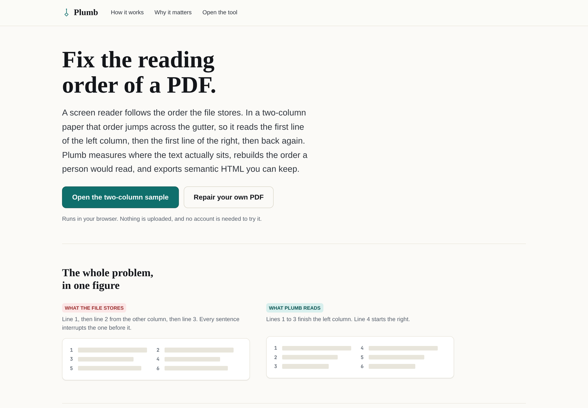
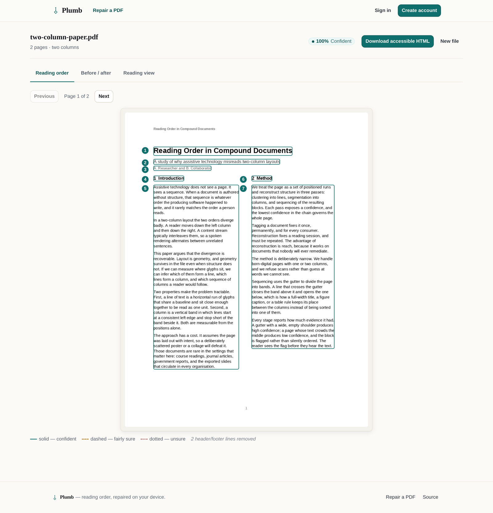

# Plumb

**Screen readers read PDFs in the wrong order. Plumb repairs it in your browser.**

Most PDFs carry no structure: no headings, no paragraphs, no reading order. A screen
reader can only follow the order the file happens to store. In a two-column academic
paper that order interleaves the columns, so a blind student hears the left column and
the right column alternating sentence by sentence: "The method we propose… Results show
that… which we evaluate on… the accuracy improves by…".

Plumb reconstructs the real reading order from the page geometry, shows every decision it
made, and hands back semantic HTML you can open in whatever screen reader you already use.

It runs entirely on your device: no upload, no API key, no server, and it keeps working
with the network switched off.

**[Try it →](https://plumb-akw.pages.dev)**



---

## The problem, concretely

A PDF is a bag of positioned glyphs. "Two columns" is not a property of the file; it is a
pattern a human eye infers. Because the file stores no structure, a screen reader falls
back to the order the glyphs were written in, which in a LaTeX-produced paper is usually
"first line of left column, first line of right column, second line of left…".

The usual fix is to open the PDF in Acrobat and tag it by hand, page by page. That takes
hours per document, needs a paid licence, and in many institutions needs a disability
office registration first. Most existing tools *diagnose* the problem, telling you a
document is untagged, rather than repairing it.

## What Plumb does



1. **Extract**: every text run with its exact page position, using pdf.js in a web worker.
2. **Reconstruct**: runs are clustered onto baselines, columns are found from a
   character-density profile, spanning lines split the page into bands, and repeated
   headers and footers are suppressed.
3. **Show**: a numbered overlay draws the inferred order on the real page, and a
   before/after view puts the stored order beside the repaired one.
4. **Read**: a reflowed reading view with synchronised text-to-speech.
5. **Export**: semantic HTML with real `<h1>`, `<h2>`, `<p>`, `<ul>`, the durable
   artifact you open in whatever assistive technology you already use.

## Why the geometry approach

The naive way to find columns is to look for a vertical band of the page that no text
touches. That fails on exactly the documents that matter: a full-width title, a spanning
figure, or a wide table row crosses the gutter, so the gutter is never empty and the page
is misread as a single column.

Plumb builds a character-density profile across the page width and looks for the *thinnest*
slice relative to the density either side of it. Lines are classified as left, right, or
**spanning**, and the page is split into horizontal bands at each spanning line. Within a
band the order is left then right; across bands it is top to bottom. That is what makes a
title land before both columns and a caption stay with its figure.

## Limitations

- **Scanned documents are not supported.** There is no OCR. Plumb detects a scan and says
  so instead of returning garbage.
- **Three-column layouts** are not handled. One and two columns are.
- **Complex tables** are not reconstructed as tables; their text is sequenced as text.
- **Mathematics** is not spoken correctly. Use a dedicated math tool for that.
- **Right-to-left scripts** are not handled.
- **Text over background images** and unusual font encodings can lose runs.

Where the pipeline is unsure it says so per block, with a confidence figure. A visible
"I am not sure" is more useful than a confident wrong answer.

## Architecture

```
                       ┌─────────────────────────────────────────┐
  PDF file (local) ───▶│  extract.ts, pdf.js in a web worker     │
                       │  every text run + its page position     │
                       └────────────────────┬────────────────────┘
                                            │ TextRun[]
                       ┌────────────────────▼────────────────────┐
                       │  lines.ts, cluster runs onto baselines  │
                       │  split on gaps wider than 1.2em         │
                       └────────────────────┬────────────────────┘
                                            │ Line[]
                       ┌────────────────────▼────────────────────┐
                       │  layout.ts, density profile → gutter    │
                       │  columns, spanning lines, running       │
                       │  headers/footers suppressed             │
                       └────────────────────┬────────────────────┘
                                            │ LayoutInfo
                       ┌────────────────────▼────────────────────┐
                       │  sequence.ts, band the page, order it,  │
                       │  group into blocks, classify, score     │
                       └────────────────────┬────────────────────┘
                                            │ Block[]
              ┌─────────────────────────────┼─────────────────────────────┐
              ▼                             ▼                             ▼
      ┌───────────────┐           ┌─────────────────┐          ┌──────────────────┐
      │ PageOverlay   │           │  ReadingView    │          │  export.ts       │
      │ numbered,     │           │  reflow + TTS   │          │  semantic HTML   │
      │ auditable     │           │                 │          │  ← the artifact  │
      └───────────────┘           └─────────────────┘          └──────────────────┘
```

Everything after `extract` is a pure function of extracted geometry, which is why the
whole pipeline is unit-testable without a browser or a PDF.

### Accounts and storage

The tool works without an account. Signing in (Clerk) adds a library that follows you
between devices, and the split is deliberate:

| Where | What | Why |
| :-- | :-- | :-- |
| IndexedDB, this browser | The full analysis and the source file | Megabytes of geometry; never leaves the device |
| Clerk `unsafeMetadata` | A small index: id, title, page count, confidence, date | Syncs across devices |

The account therefore knows *which* documents you opened, never what is inside them.

## Run it

```bash
git clone https://github.com/MirzaAliAkbar/plumb.git
cd plumb/app
npm install

cp .env.example .env.local   # then paste your Clerk publishable key
npm run dev
```

The app is a static single-page build; there is no backend to run.

```bash
npm run build     # → dist/
npm run preview   # serve the production build locally
```

### Deploy

Static output, so any static host works. This deployment targets Cloudflare Pages:

```bash
npm run deploy
```

`public/_redirects` provides the SPA fallback so `/app` and `/library` survive a refresh.

## Tests

```bash
npm test              # 85 unit tests: pipeline, HTML export, error taxonomy, storage
npx playwright test   # 19 end-to-end: axe WCAG 2.2 AA, real offline, routing
```

The end-to-end suite includes a genuine offline test: it lets the service worker install,
cuts the network, reloads, and analyses a PDF. That only passes because pdf.js's worker and
font data are precached. They load lazily on first use, so on-demand caching would leave
the shell working and extraction broken.

## Tech

React 19 · TypeScript · Vite 8 · pdf.js · Clerk · hand-written CSS (no UI framework) ·
Vitest · Playwright + axe-core.

## Project layout

```
app/            the application
  src/lib/      the pipeline: pure functions, fully unit-tested
  src/pages/    routes: landing, tool, library, auth
  e2e/          Playwright specs, including axe and offline
docs/           submission copy, decisions, evidence
```

## Licence

MIT. See [LICENSE](LICENSE).
